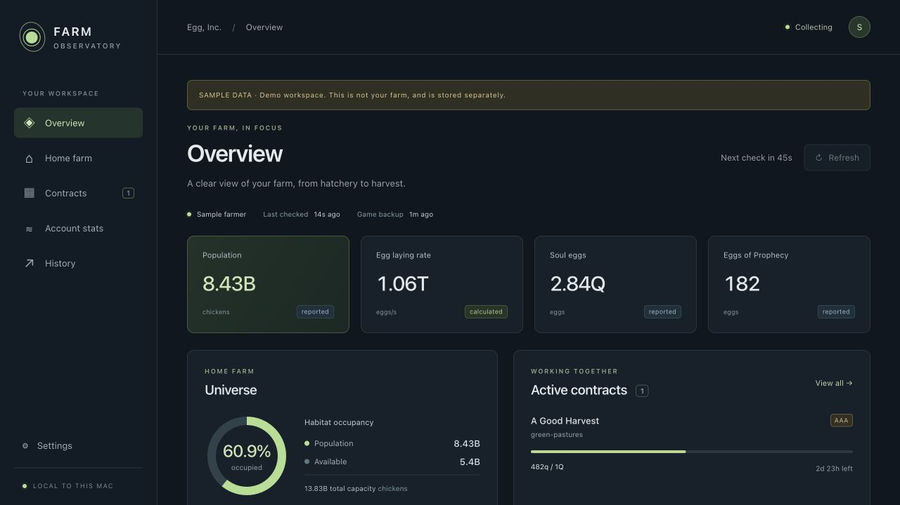
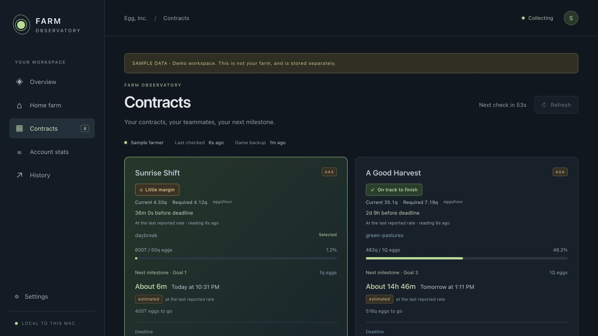

# Farm Observatory · Egg, Inc. Dashboard

A local dashboard for your home farm, contract farms, co-op partners, and account stats. Runs on your computer at **http://localhost:8890**, records SQLite history while the server is running, and never requires an EID in source code or a URL.

This repository is the app, with synthetic demo data. **No player's account, saved game, EID, or recorded history is included.** Each player connects their own EID locally after starting it.



## Start on a Mac

1. Install **Node.js 24** from [nodejs.org](https://nodejs.org/).
2. Download this repository using **Code → Download ZIP**, then extract it into a folder you want to keep.
3. Double-click **Start Dashboard.command**. It installs the locked dependencies and builds the interface on the first launch. If macOS asks you to approve opening the downloaded script, use the terminal instructions below instead.
4. Open **http://localhost:8890**. Copy your EID from Egg, Inc.’s **Privacy & Data** screen and enter it into the local setup form.

For a preview without an account, double-click **Start Demo.command**. The demo is labeled and uses a separate database.

### Terminal setup

In the extracted repository folder:

```sh
npm ci --no-audit --no-fund
npm start
```

To use only synthetic sample data:

```sh
npm run demo
```

Node 24 is required for the built-in SQLite database. These commands also work on Linux; the double-click launchers are for macOS. Windows is not yet verified.

Keep the Terminal window running to collect observations. Collection continues with the browser closed, but pauses when the server stops or the computer sleeps. **Control-C** stops the server. Starting it again preserves history. No automatic startup or background installation is added.

Only one server can use port 8890. To preview the demo alongside a running dashboard on macOS/Linux:

```sh
DASHBOARD_PORT=8891 npm run demo
```

Then open http://localhost:8891. The port is local to that computer; it is not a hosted or publicly accessible dashboard.

## What it shows

- Home-farm population, habitat occupancy, actual purchased-upgrade rates, equipped artifacts, and active boosts.
- All active contracts at once, next-milestone ETAs with local completion times, delivered-egg milestones, and sortable co-op members.
- Final-goal pace badges, required production rate, finish margin, milestone rewards, and sortable member production bottlenecks.
- Blue/red population comparisons, recorded habitat capacity, occupancy bars, and **Habs full** badges.
- Account counters, selectable history ranges, exact saved values, and CSV export.
- Refresh/pause controls, 60/120/300-second collection, and explicit local-data deletion.

“Live” means checking the latest uploaded game data. The dashboard cannot force a game sync. Reported values and conditional forecasts are labeled separately. Read [features and accuracy limits](docs/FEATURES.md) for details.



## Privacy

- Your EID is entered only in your local browser and stored in **`data/farm.sqlite`** on your own computer, alongside the latest game responses and normalized history.
- The server makes read-only gameplay requests directly to Auxbrain’s game API. No account data is sent to this repository, its owner, an analytics service, or a hosted relay.
- The server binds to IPv4 loopback and checks Host and Origin. EIDs are masked in public dashboard state; member identifiers are hashed before reaching history URLs. Request logging is disabled.
- Database files, exports, `.env` files, logs, dependencies, and build output are ignored by Git and excluded from release ZIPs.
- **Do not upload your `data/` folder, CSV exports, or screenshots of your real farm to issues or pull requests.** Use demo mode for screenshots. See [privacy and reporting](PRIVACY.md).

The database contains your private game information. To back it up, stop the server and copy it somewhere private. Settings lets you explicitly delete local records without changing your game. History begins when collection starts and is not reconstructed from earlier gameplay.

## Development

```sh
npm ci --no-audit --no-fund
npm test
npm run build
npm run privacy:check
```

`npm start` builds and serves the UI and API together. For Vite development, run the API with `DASHBOARD_DEV=1 node --import tsx server/index.ts`, then run `npm run dev` in another terminal. Vite proxies `/api` to port 8890.

All automated tests use synthetic fixtures and temporary/in-memory databases. CI checks Node 24 on macOS and Linux. To create a clean source ZIP from committed files:

```sh
npm run release:zip
```

The archive goes into the ignored `releases/` directory. The release checker rejects runtime data, local machine paths, likely credentials, and EIDs other than the explicitly synthetic fixtures. Always review a release before sharing it.

`DASHBOARD_DATA` can override the database path for isolated development. `DASHBOARD_PORT` changes the loopback port. The demo launcher always selects its separate demo database.

## Credits and ownership

An unofficial community companion, not affiliated with or endorsed by Auxbrain. Egg, Inc. and the game artwork belong to Auxbrain.

Research formulas and tables draw on [Wasmegg Carpet](https://github.com/wasmegg-carpet/egg). Protocol, artifact lookup code, and images were adapted from [EI Coop Assistant](https://github.com/Kaylier/ei-coop-assistant). Request envelope behavior was informed by [ei_worker](https://github.com/tylertms/ei_worker).

See [third-party notices](THIRD_PARTY_NOTICES.md) and [LICENSE](LICENSE) for attribution and license boundaries.
